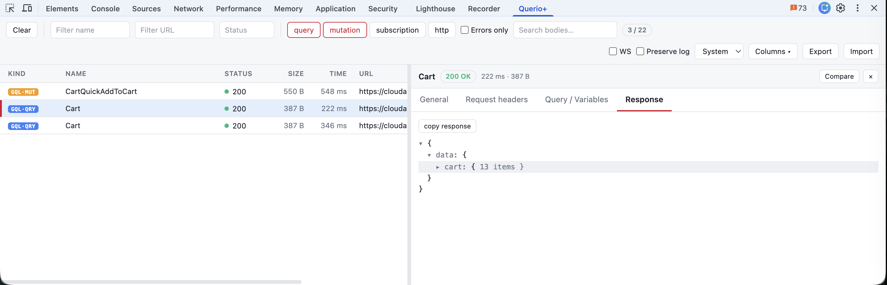

# Querio+

[](LICENSE)
[](https://nodejs.org/)
[](https://www.typescriptlang.org/)

A Chrome DevTools extension for inspecting **GraphQL** and HTTP requests. Features filtering,
search, JSON tree view, request comparison, and session export.



## Features

- 🔍 **GraphQL Detection** — Automatically detects GraphQL operations (queries, mutations, subscriptions)
- 🔌 **WebSocket Subscriptions** — Captures real-time GraphQL subscriptions (graphql-ws & subscriptions-transport-ws)
- 📦 **Batch Splitting** — Splits batched GraphQL arrays into individual operations
- 🎯 **Smart Filtering** — Filter by name, URL, status, type, or errors only
- 🔎 **Full-text Search** — Search across request and response bodies
- 🌳 **JSON Tree View** — Collapsible, syntax-highlighted response viewer
- 📋 **Copy Actions** — Copy as cURL, operation, or response
- ⚖️ **Request Diff** — Compare responses, queries, variables, and headers between requests
- 📊 **Waterfall View** — Timeline visualization showing request timing breakdown (DNS, connect, SSL, wait, receive)
- 💾 **Session Export** — Export/import sessions as JSON
- 🎨 **Themes** — Light, dark, and system theme support
- ⌨️ **Keyboard Navigation** — Browse requests with arrow keys

## Installation

### From GitHub Releases (Recommended)

1. Download the latest `querio-plus-vX.Y.Z.zip` from [Releases](https://github.com/yquoulali/querio-plus/releases)
2. Unzip to a folder
3. Go to `chrome://extensions`
4. Enable **Developer mode**
5. Click **Load unpacked** → select the unzipped folder
6. Open DevTools (F12) → find the **Querio+** tab

### From Source

```bash
# Clone the repository
git clone https://github.com/yquoulali/querio-plus.git
cd querio-plus

# Install dependencies
pnpm install

# Build
pnpm build
```

Then load in Chrome:
1. Go to `chrome://extensions`
2. Enable **Developer mode**
3. Click **Load unpacked** → select the `dist/` folder
4. Open DevTools (F12) → find the **Querio+** tab

## Development

```bash
pnpm dev         # Watch mode for development
pnpm build       # Production build
pnpm test        # Run tests
pnpm typecheck   # TypeScript check
pnpm package     # Create ZIP for Chrome Web Store
```

### Releasing

```bash
pnpm release 0.3.0   # Build, test, and publish v0.3.0 to GitHub Releases
pnpm release         # Use version from package.json
pnpm release:dry     # Dry run (build + package only, no publish)
```

The release script:
- Runs tests and builds the extension
- Creates a versioned ZIP (`querio-plus-vX.Y.Z.zip`)
- Generates changelog from commits since the previous tag
- Publishes to GitHub Releases with the ZIP attached

## How It Works

Querio+ captures network traffic through the Chrome DevTools API (`chrome.devtools.network`).
It detects GraphQL operations by parsing request bodies and validating with the `graphql` library.

Key features:
- **No background scripts or content scripts** — minimal permissions
- **Lazy body loading** — responses are fetched on demand
- **Request de-duplication** — handles Chrome's double-delivery quirk
- **Bounded memory** — limits prevent freezing on large sessions

See [docs/ARCHITECTURE.md](docs/ARCHITECTURE.md) for the full technical design.

## Comparison with Querio

Querio+ is an improved reimplementation inspired by [Querio](https://github.com/enkot/querio).
Key improvements:

| Feature | Querio | Querio+ |
|---------|--------|---------|
| Batch correlation | Positional only | Identity-first (fixes reorder bugs) |
| Filtering | ❌ | ✅ Name, URL, status, type, errors |
| Body search | ❌ | ✅ Full-text search |
| Request diff | ❌ | ✅ Compare response/query/variables/headers |
| Session export | ❌ | ✅ HAR-like JSON |
| Resizable columns | ❌ | ✅ Persistent widths |
| De-duplication | ❌ | ✅ Handles Chrome double-delivery |
| Memory bounds | — | ✅ No freeze on large payloads |
| Multipart uploads | ❌ | ✅ GraphQL file upload detection |
| Incognito mode | ❌ | ✅ Works in private browsing |
| WebSocket subscriptions | ❌ | ✅ Real-time subscription capture |
| Waterfall view | ❌ | ✅ Request timing visualization |

## Roadmap / Known Limitations

### WebSocket Subscriptions (Optional)

Querio+ can capture GraphQL subscriptions over WebSocket. This feature is **off by default** because it requires Chrome's debugger API, which shows a notification banner.

To enable:
1. Check the **WS** checkbox in the toolbar
2. Chrome will show: *"Querio+ started debugging this browser"* — this is normal
3. Subscriptions will now appear with a `GQL·SUB` badge

Supports both `graphql-ws` (modern) and `subscriptions-transport-ws` (legacy) protocols.

## Contributing

Contributions are welcome! See [CONTRIBUTING.md](CONTRIBUTING.md) for guidelines.

## License

[MIT](LICENSE) — Based on [Querio](https://github.com/enkot/querio) by enkot (MIT).

## Acknowledgments

Thanks to [enkot](https://github.com/enkot) for the original [Querio](https://github.com/enkot/querio)
extension that inspired this project.
